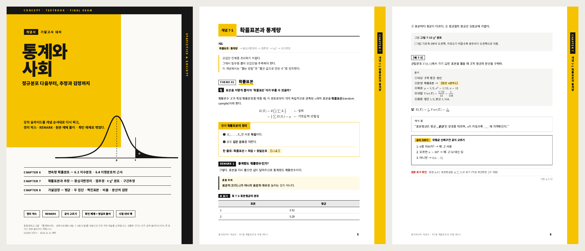
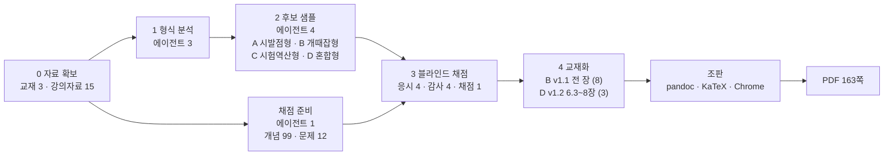

# Make a Wonderful Book

교수님 강의 PPT로는 공부가 안 돼서, **시중 수학 개념서의 "형식"을 벤치마킹해 기말고사용 개념서를 만든** 프로젝트.
Claude 에이전트 31개로 형식 분석 → 후보 4개 제작 → 블라인드 채점 → 교재화 → PDF 조판까지 하루 만에 진행했다.

- 과목: 중앙대학교 교양 「통계와사회」 (2026년 2학기)
- 벤치마킹 교재: 2022 개정 시발점 확률과 통계, 개념때려잡기 확통, 개념 때려잡기 미적분 — **내용이 아니라 구성 방식만** 참고
- 결과: D 혼합형 개념서 PDF 163쪽 (6.3 지수분포 ~ 8장 가설검정)


<sub>예시 원고(typeset/fixture.md)로 조판한 표지와 본문. 실제 교재 PDF는 강의 내용을 담고 있어 레포에 넣지 않았다.</sub>

## 파이프라인



자세한 단계·에이전트·시간 → [docs/pipeline.md](docs/pipeline.md)

## 형식 테스트 결과 (제7장)

| 항목 | 만점 | A 시발점형 | B 개때잡형 | C 시험역산형 | D 혼합형 |
|---|---|---|---|---|---|
| 누락 (개념 99개) | 25 | 25 | 25 | 25 | 25 |
| 시험 대비력 | 30 | 29.8 | 30.0 | 30.0 | 30.0 |
| 이해 용이성 | 15 | 10.1 | **11.6** | 10.5 | 9.4 |
| 정확성 감점 | −10 | −2 | 0 | −4 | 0 |
| AI 합계 | 70 | 62.9 | **66.6** | 61.5 | 64.4 |
| 본인 평가 | 30 | | | | **선택** |

AI 채점 1등은 B였지만 직접 읽어 보고 **D 혼합형**을 골랐다. 해석과 형식별 장단점 → [docs/results.md](docs/results.md)

## 레포 구성

```
docs/        plan.md 처음 계획과 검토 · pipeline.md · results.md · lessons.md 배운 점
prompts/     에이전트에 준 지시서와 프롬프트 (단계별 00~06)
specs/       1단계 산출물: 교재 3권의 형식 명세서
templates/   2단계 산출물: 후보 형식 4개의 재사용 템플릿 (A~D)
eval/        채점표(rubric) · 점수표
typeset/     원고 → PDF 조판기 (build · katexify · render · assemble · style.css · 표지)
tools/       to_notion_md.py — 마크다운 → 노션용 마크다운 변환
examples/    예시 원고로 조판한 PDF와 미리보기
```

## 조판기 실행

```bash
# 필요: pandoc 3, Node 18+, Python 3.11+, Chrome/Chromium, 한글 폰트(Noto Sans CJK KR)
pip install beautifulsoup4 playwright pypdf scipy
cd typeset && npm install

# 장별 HTML 만들기: build.py 원고.md 출력폴더 장번호 "장 제목" "세로띠 짧은 제목"
python3 build.py fixture.md out 7 "확률표본과 추정 (예시)" "확률표본과 추정"
# 한 권으로 합치기: 표지·구성과 특징·차례·본문·정답과 풀이·부록 분포표
python3 assemble.py out out/book.pdf fixture
```
원고 마크업 규칙(정리 박스·REMARK·예제·확인 예제 등)은 [prompts/05_D_BRIEF_v1.2.md](prompts/05_D_BRIEF_v1.2.md).

## 레포에 넣지 않은 것
저작권과 개인 학습용 원칙 때문에 아래는 로컬(맥 `다운로드/통계와사회_교재화/`)에만 있다.
- 강의 슬라이드 원본(PDF·텍스트·이미지), 벤치마킹 교재 스캔본
- 강의 내용을 담은 산출물: 장별 원고, 최종 PDF, 7장 샘플 4개, 개념 체크리스트·예상문제·답안·감사 보고서

프롬프트 안의 경로(`/home/claude/...`)는 작업할 때 쓴 클라우드 작업 공간 기준이다.
