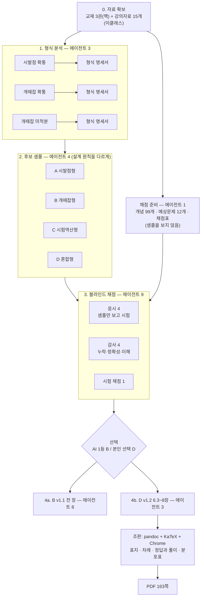

# 전체 파이프라인



## 단계별 상세

| 단계 | 에이전트 | 입력 | 출력 | 걸린 시간(약) |
|---|---|---|---|---|
| 0 자료 확보 | – | 맥 다운로드 폴더, 이클래스(Composio Canvas → LearningX API), CAU 노션 | 교재 PDF 3, 강의 PDF 15, 페이지 텍스트·슬라이드 이미지 | 15분 |
| 1 형식 분석 | 3 | 스캔 교재 (목차·사용법·대표 단원) | `specs/` 형식 명세서 3 | 3~5분 |
| 채점 준비 | 1 | 7장 원본 45쪽 | 개념 99 · 예상문제 12 · 채점표 | 6분 |
| 2 후보 샘플 | 4 | 명세서 3 + 7장 원본 | `templates/` 4 + 7장 샘플 4 | 11~14분 |
| 3 채점 | 9 | 샘플 + 채점 자료 (역할마다 볼 수 있는 파일 제한) | 답안 4, 감사 4, 점수표 | 1~5분 |
| 4a B v1.1 | 8 | 장별 원본 + 템플릿 B + 보완 규칙 10 | 1~8장 마크다운 (약 15,000줄) | 7~17분 |
| 4b D v1.2 | 3 | 장별 원본 + 템플릿 D + 보완 규칙 7 + 조판 마크업 규칙 | 6.3~8장 원고 (약 4,900줄) | 7~20분 |
| 조판 | – | 원고 3 | PDF 163쪽 | 1분 |
| 노션 업로드 | 1 (+2 중단) | 노션용 마크다운 조각 | 후보 샘플 4페이지 | – |

에이전트 총 31개 (중단 2개 포함).

## 조판 (typeset/)

```
원고 .md ──preprocess──▶ pandoc(html5, --katex) ──katexify.js──▶ KaTeX HTML
        ──build.py(BeautifulSoup)──▶ 블록 → 디자인 요소 (정리 박스·REMARK·예제·확인 예제 번호·풀이 분리)
        ──render.py(Chrome)──▶ 장별 PDF
assemble.py: 표지 + 구성과 특징 + 차례(쪽 번호 자동) + 장 PDF + 정답과 풀이(2단) + 부록 분포표(scipy)
           + 오버레이(오른쪽 세로띠에 현재 개념, 쪽 번호) → pypdf로 합치기
```

마크업 → 디자인 대응

| 원고 블록 | 디자인 |
|---|---|
| `## 개념 7-1 …` | 노란 번호 + 굵은 제목, 새 쪽, 세로띠에 표시 |
| `### THEME 01 …` | 테두리 번호 + 노란 밑줄 |
| `::: summary` | 노란 테두리 [정리] 박스, "한 줄로" 구분선 |
| `::: remark` | 검정 REMARK 라벨 (THEME마다 번호 리셋) |
| `::: example` | [예 7-3] 라벨 + 회색 풀이 칸 |
| `::: problem` | 노란 원 번호 + 메타(유형·난이도·근거) + 풀이 공간, 풀이는 책 뒤로 이동 |
| `::: pick` / `::: tableread` / `::: figure` / `::: interp` | 공식 고르기 / 표 읽기 / 회색 그림 상자 / 점선 해석 틀 |
| `::: origerr` | 빨간 "원본 표기 확인" 한 줄 |
| `【태그】` | 연노랑 글씨 |
